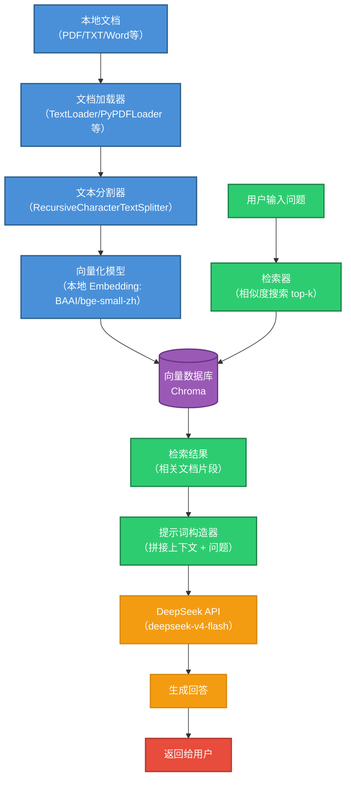

# 🧠 本地 RAG 系统搭建（Windows 版）

---

## 📖 目录

- [一、DeepSeek API 本地 RAG 系统构成图](#一deepseek-api-本地-rag-系统构成图)
- [二、环境准备](#二环境准备)
- [三、安装 Python 依赖包](#三安装-python-依赖包)
- [四、项目文件结构](#四项目文件结构)
- [五、完整代码（rag_run.py）](#五完整代码rag_runpy)
- [六、运行步骤](#六运行步骤)

---

## 一、DeepSeek API 本地 RAG 系统构成图



> 💡 **知识点：RAG 是什么？**
> RAG（检索增强生成）就是「**先检索，再生成**」：大模型回答前，先从你的知识库中检索出最相关的文档片段，拼进提示词一起发给模型。
> 这样模型就能回答**训练数据里没有的私有知识**，还能避免凭空编造（幻觉），并且答案可溯源到具体文档。
> 整个流程分两段：
> - **离线阶段（建库）**：文档加载 → 切分 → 向量化 → 存入向量数据库；
> - **在线阶段（问答）**：问题向量化 → 相似度检索 top-k → 拼接上下文 → 调用大模型生成。

---

## 二、环境准备

### 必须安装的软件

| 软件/组件 | 版本要求 | 下载地址 | 关键操作 |
| :--- | :--- | :--- | :--- |
| **Python** | **3.12.x**（不要安装 3.13+） | [python.org](https://www.python.org/downloads/) | 安装时**务必勾选** “Add Python to PATH” |
| **Git** | 最新版 | [git-scm.com](https://git-scm.com/download/win) | 默认安装即可 |
| **Visual C++ Build Tools** | 2019 或更新 | [微软官网](https://visualstudio.microsoft.com/zh-hans/visual-cpp-build-tools/) | 运行后勾选 **“C++ 桌面开发”**，点击安装 |

> 💡 **知识点：为什么要求这些组件？**
> - **Python 3.12.x**：`sentence-transformers`、`chromadb` 等库对 3.13+ 的预编译包支持尚不完善，3.12 是当前兼容性最好的版本；
> - **Git**：部分依赖包安装时需要从 Git 仓库拉取元数据，同时方便你日后做版本管理；
> - **Visual C++ Build Tools**：`chromadb` 等含 C++ 扩展的库在 Windows 上需要编译工具链，缺少时会报 `Microsoft Visual C++ 14.0 or greater is required` 错误。
>
> ⚠️ **验证安装**：在 PowerShell 执行 `python --version`，应输出 `Python 3.12.x`；执行 `git --version` 验证 Git。

---

## 三、安装 Python 依赖包

打开 **PowerShell**（或 CMD），依次执行以下命令：

```powershell
# 升级 pip（避免安装卡顿）
python -m pip install --upgrade pip

# 安装所有必需库（包含最新模块，解决弃用警告）
pip install langchain langchain-community chromadb sentence-transformers openai tiktoken pypdf docx2txt langchain-text-splitters langchain-huggingface
```

> 💡 **知识点：每个库是干什么的？**
>
> | 库 | 作用 |
> | :--- | :--- |
> | `langchain` / `langchain-community` | LangChain 框架核心 + 社区集成（加载器、向量库等） |
> | `langchain-text-splitters` | 文本分割器（`RecursiveCharacterTextSplitter` 等） |
> | `langchain-huggingface` | Hugging Face 生态的官方适配（新版 `HuggingFaceEmbeddings` 所在） |
> | `sentence-transformers` | 本地 Embedding 模型运行引擎（bge 系列模型依赖它） |
> | `chromadb` | 本地向量数据库 |
> | `openai` | DeepSeek 的 API 兼容 OpenAI 格式，用它作为客户端 |
> | `tiktoken` | Token 计数工具（分割/预算估算用） |
> | `pypdf` / `docx2txt` | 读取 PDF / Word 文档的解析器 |
>
> 🚀 **加速小技巧**：下载慢时可临时使用国内镜像源：
> ```powershell
> pip install -i https://pypi.tuna.tsinghua.edu.cn/simple <包名>
> ```

---

## 四、项目文件结构

在**工作目录**（本示例为 `D:\WORK\python\`）下创建项目文件夹，结构如下：

```
python/                              # 你的工作目录（示例：D:\WORK\python\）
├── myrag1/                          # 项目主目录（存放 Python 程序）
│   └── rag_run.py                   # 主程序
├── knowledge/                       # 存放本地文档的文件夹（代码中为 ../knowledge）
│   └── test.txt                     # 测试文档
└── vector_db/                       # 向量数据库（运行后自动创建，代码中为 ../vector_db）
    └── chroma.sqlite3               # Chroma 持久化文件
```
---

## 五、完整代码（`rag_run.py`）

复制以下代码到 `rag_run.py` 中。**务必把 `DEEPSEEK_API_KEY` 换成你自己的真实密钥**（在 [DeepSeek 开放平台](https://platform.deepseek.com/) 申请）。

```python
from langchain_community.document_loaders import TextLoader
from langchain_text_splitters import RecursiveCharacterTextSplitter
from langchain_community.embeddings import HuggingFaceEmbeddings
from langchain_community.vectorstores import Chroma
from openai import OpenAI
import os

# ========== 配置区（只改这里！）==========
DEEPSEEK_API_KEY = "sk-你的真实密钥"  # 替换为你的 DeepSeek API 密钥
KNOWLEDGE_PATH = "../knowledge"  # 文档文件夹路径
PERSIST_DIR = "../vector_db"     # 向量数据库存储路径（自动创建）
# ========================================

print("🚀 开始搭建本地 RAG...")

# 1️⃣ 加载本地文档
print("📄 正在读取文档...")
loader = TextLoader(f"{KNOWLEDGE_PATH}/test.txt", encoding="utf-8")
documents = loader.load()

# 2️⃣ 切分文档（每段 200 字，重叠 20 字）
print("✂️ 正在切分文档...")
text_splitter = RecursiveCharacterTextSplitter(chunk_size=200, chunk_overlap=20)
chunks = text_splitter.split_documents(documents)
print(f"   共切分为 {len(chunks)} 个片段")

# 3️⃣ 向量化并存入 Chroma（完全在本地运行，不消耗 API 额度）
print("🧠 正在向量化...")
embeddings = HuggingFaceEmbeddings(model_name="BAAI/bge-small-zh-v1.5")
vector_store = Chroma.from_documents(
    documents=chunks,
    embedding=embeddings,
    persist_directory=PERSIST_DIR
)
vector_store.persist()
print("✅ 知识库已存入本地向量数据库")

# 4️⃣ 初始化 DeepSeek 客户端
print("🔗 连接 DeepSeek API...")
client = OpenAI(
    api_key=DEEPSEEK_API_KEY,
    base_url="https://api.deepseek.com/"
)

# 5️⃣ 定义问答函数
def ask(question):
    # 检索最相关的 3 个片段
    retriever = vector_store.as_retriever(search_kwargs={"k": 3})
    docs = retriever.invoke(question)
    context = "\n\n".join([doc.page_content for doc in docs])
    
    # 构造提示词
    prompt = f"""请根据以下参考文档回答用户问题。如果文档里没有相关信息，请直接说"未找到相关答案"。

【参考文档】
{context}

【用户问题】
{question}"""
    
    # 调用 DeepSeek API
    response = client.chat.completions.create(
        model="deepseek-v4-flash",
        messages=[{"role": "user", "content": prompt}],
        temperature=0.3
    )
    return response.choices[0].message.content

# 6️⃣ 启动交互式问答
print("\n" + "="*50)
print("💬 RAG 已就绪！输入问题开始对话（输入 exit 退出）")
print("="*50 + "\n")

while True:
    q = input("👤 您: ")
    if q.lower() == "exit":
        print("👋 再见！")
        break
    try:
        answer = ask(q)
        print(f"🤖 DeepSeek: {answer}\n")
    except Exception as e:
        print(f"❌ 发生错误: {e}\n")
        print("提示：请检查 API Key 是否正确，以及额度是否充足")
```

> ⚠️ **安全提醒：API 密钥请勿硬编码进代码！**
> 把密钥写死在代码里，一旦代码被分享、提交到 Git 仓库，密钥就等于公开泄露。
> 更安全的做法是使用**环境变量**：
> ```python
> import os
> DEEPSEEK_API_KEY = os.environ.get("DEEPSEEK_API_KEY", "")
> ```
> 运行时设置：`$env:DEEPSEEK_API_KEY = "sk-xxx"; python rag_run.py`。
> 如果你已经把自己的真实密钥贴到过文档或公开仓库，建议立即到 DeepSeek 开放平台**吊销并重新生成**。

> 💡 **知识点：代码里几个值得注意的细节**
> - **本地 Embedding 不消耗 API 额度**：向量化用的是本地小模型（约 100MB），只有最后生成回答那一步才调用 DeepSeek API（按 token 计费）；
> - **`HuggingFaceEmbeddings` 的新地址**：从 `langchain_community.embeddings` 导入是旧写法（会有弃用警告），新写法是 `from langchain_huggingface import HuggingFaceEmbeddings`，两者用法一致；
> - **`vector_store.persist()` 在新版中可省略**：新版 Chroma 写入即持久化，`persist()` 调用会提示弃用，保留也不影响运行；
> - **`chunk_size=200, chunk_overlap=20`**：每个片段约 200 字、相邻片段重叠 20 字，避免语义在切分处被截断（详见 RAG2.md 第五节）。

---

## 六、运行步骤

### 第 1 步：准备测试文档

在 `knowledge` 文件夹（`python\knowledge\`）下创建 `test.txt`，写入任意内容，例如：

```
DeepSeek 是一家中国的人工智能公司，专注于大语言模型的研发。
它的 API 接口兼容 OpenAI 的格式，方便开发者迁移。
DeepSeek 的模型在中文理解方面表现出色。
```

### 第 2 步：运行程序

在同一个 PowerShell 窗口（确保环境变量已配置好）中，切换到项目目录并执行：

```powershell
cd D:\WORK\python\myrag1
python .\rag_run.py
```

### 第 3 步：观察运行结果

- 首次运行会自动下载 `BAAI/bge-small-zh-v1.5` 模型（约 100MB），进度条会正常前进；
- 出现 `✅ 知识库已存入本地向量数据库` 表示向量化完成；
- 交互问答测试：

```powershell
👤 您: 什么是DeepSeek
🤖 DeepSeek: 根据参考文档，DeepSeek 是一家中国的人工智能公司，专注于大语言模型的研发，其 API 接口兼容 OpenAI 格式，且模型在中文理解方面表现出色。

👤 您: 什么是智谱AI
🤖 DeepSeek: 未找到相关答案

👤 您: exit
👋 再见！
```

> 💡 **知识点：为什么问「智谱AI」会得到"未找到相关答案"？**
> 因为知识库里根本没有智谱AI 的内容，检索不到相关片段，模型就如实回答未找到。
> 这正是 RAG 的核心价值：**模型只依据你的知识库作答，不会凭空编造**。想让它认识新概念，往 `knowledge/` 里加文档即可（重新运行一次程序即可重建索引）。

### 第 4 步：常见报错排查

| 报错现象 | 原因 | 解决方法 |
| :--- | :--- | :--- |
| `ModuleNotFoundError: No module named 'langchain_...'` | 依赖没装全 | 重新执行第三节的 `pip install` 命令 |
| `Microsoft Visual C++ 14.0 or greater is required` | 缺少 C++ 编译工具 | 安装 Visual C++ Build Tools 并勾选“C++ 桌面开发” |
| `401` / `Authentication Fails` | API Key 错误或过期 | 检查 `DEEPSEEK_API_KEY`，到开放平台重新生成 |
| `402` / `Insufficient Balance` | 账户余额不足 | 到 DeepSeek 开放平台充值 |
| 首次运行时模型下载卡住 | 网络访问 Hugging Face 受限 | 设置镜像 `$env:HF_ENDPOINT = "https://hf-mirror.com"` 后重试 |
| `Knowledge base not initialized` | 向量库目录被破坏 | 删除 `vector_db/` 目录后重新运行 |

---
